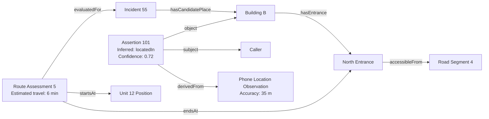
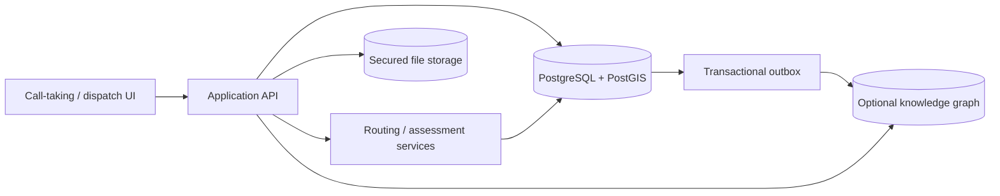

# Incident Ontology and Visual Demo: Chat Transcript

Date: 2026-10-05. Message timestamps are UTC.

Export of the available user and assistant messages through the request to save this chat. Message text is preserved, including progress updates, code blocks, tables, and diagrams. Tool calls, tool outputs, internal reasoning, and attachment contents are excluded. The available transcript starts with an assistant response; the original opening user question is not present. Links are preserved as originally written and may be relative to the workspace root.

---

## Assistant (2026-10-05 12:17:33 UTC)

I’ll check a few ontology viewers and graph libraries, focusing on which could show your example clearly and what format they need.

---

## Assistant (2026-10-05 12:18:00 UTC)

Yes. **For your example, I’d shortlist WebVOWL for the ontology itself and Cytoscape.js for an interactive incident graph.** Mermaid is the quickest way to get an initial diagram into your notes.

**Two Different Views**
Your document contains two things worth visualizing separately:

- **Ontology/schema:** the concepts and permitted relationships, such as `Building → hasEntrance → Entrance`.
- **Instance graph:** a specific scenario, such as `Building B → hasEntrance → North Entrance`, including observations, confidence, and recommendations.

Ontology-specific tools primarily address the first; general graph libraries give you more control over the second.

**Options**
| Tool | Best For | Fit for Your Example | Main Tradeoff |
|---|---|---|---|
| **[WebVOWL](https://service.tib.eu/webvowl/)** | Interactive OWL ontology visualization | Classes, properties, inheritance, and connections between modules | Requires a formal ontology converted through OWL2VOWL; not designed as an operational incident viewer |
| **[Protégé](https://protege.stanford.edu/)** | Ontology authoring and inspection | Defining and checking the actual OWL model, with graph views through plugins such as OntoGraf | Desktop application, not an embeddable web library |
| **[Cytoscape.js](https://js.cytoscape.org/)** | Interactive knowledge-graph exploration | Incident-centered expansion, labeled relationships, module grouping, evidence highlighting | You supply node/edge JSON and implement the ontology-specific behavior |
| **[React Flow](https://reactflow.dev/)** | Custom interactive diagrams in React | Rich assertion nodes showing confidence, timestamps, and provenance | Automatic layout needs an additional engine such as ELK or Dagre; no built-in ontology semantics |
| **[Sigma.js](https://www.sigmajs.org/)** | Large network exploration | Useful when the instance graph grows to thousands of entities | WebGL favors scale; rich node content and custom rendering take more work |
| **[Mermaid](https://mermaid.js.org/)** | Documentation diagrams | Fast, readable illustrations directly in Markdown | Limited exploration; no OWL interpretation or reasoning |

Your current document is a **conceptual specification**, not yet machine-readable OWL/RDF. For WebVOWL, you would formalize its classes and properties first. For Cytoscape.js or React Flow, a small hand-authored JSON dataset is enough to begin; **no graph database is required for a prototype**.

**How I’d Visualize Yours**
I’d use three selectable views:

1. **Schema:** classes grouped by Incident, Place, Resources, Observations, and Evidence.
2. **Incident 55:** concrete entities, initially limited to relevant buildings, entrances, units, and hazards.
3. **Evidence:** expand an inferred relationship to reveal its assertion, source, derivation, and validity.

For example, this small Mermaid diagram makes the distinction between the caller’s actual location and the assertion about it explicit:



In an interactive version, you could collapse the assertion into a **dashed, labeled relationship**, then expose the evidence on selection. Keep confirmation status separate from confidence: “confirmed by caller” does not inherently mean certainty `1.0`.

**My Recommendation**
Start with **Mermaid to refine the model**, then use **Cytoscape.js with the fCoSE layout extension** for an explorable demonstration. It fits your interconnected entities and module grouping well.

Choose **React Flow instead** if the priority is a curated explanation interface with substantial content inside nodes. Choose **WebVOWL** if the immediate goal is reviewing the formal ontology rather than demonstrating emergency-response behavior.

---

## User (2026-10-05 12:35:51 UTC)

Can you guide me through the process of creating such an ontology with an example? I want you to focus on the incident example from the call taking all the way to dispatching the unit to a specific room within the building.

---

## Assistant (2026-10-05 12:36:32 UTC)

Yes. I would start with **one incident, one building, one patient, and one response unit**, then model the evidence and decisions that connect them.

The key is to distinguish **where help is needed**, **how responders reach it**, and **who authorized the response**.

**1. Define the Scenario**
Use this fictional case:

> At 14:03, a caller reports a person needing urgent medical assistance. The phone location overlaps Buildings A and B. The caller identifies Building B, second floor, Room 2.14. Building information identifies a suitable entrance and indoor access path. A dispatcher assigns Unit 12, which acknowledges the assignment.

Keep **Caller** and **Patient** separate: someone may be calling remotely or on another person's behalf. The destination is the patient’s reported location, not necessarily the caller’s.

Before defining classes, write the questions your ontology must answer:
- What was reported, by whom, and when?
- Which location is estimated, reported, or verified, and for which person?
- What uniquely identifies the building, floor, and room?
- Which entrance and indoor path reach that room?
- Which available unit meets the assessed response requirements?
- Who dispatched it, what destination was communicated, and was it acknowledged?

**2. Build a Small Vocabulary**
These are **classes**, not yet the individual objects in the example.

| Area | Initial Classes | Important Relationships |
|---|---|---|
| Incident intake | Incident, EmergencyCall, Person, CallerStatement | `reportsIncident`, `madeBy`, `aboutPerson` |
| Evidence | Observation, LocationAssertion | `subject`, `predicate`, `object`, `derivedFrom` |
| Building | Building, Floor, Room, Entrance, Door, Corridor, Stairway, Elevator | `partOf`, `connectsTo`, `hasGeometry` |
| Access | AccessPlan, RouteAssessment, AccessRestriction | `destination`, `usesEntrance`, `hasStep` |
| Resources | ResponseUnit, Capability, UnitStatusObservation | `providesCapability`, `aboutUnit` |
| Dispatch | DispatchDecision, Assignment, Acknowledgement | `authorizes`, `assignedUnit`, `destination`, `acknowledges` |

Reuse **SOSA** for observations, **PROV-O** for provenance, **OWL-Time** for intervals, and **GeoSPARQL** for geometry as you formalize the model. You do not need to import every standard immediately.

**3. Follow the Incident**
Create new records as knowledge changes instead of repeatedly overwriting one location field.

| Stage | Example Records | Meaning |
|---|---|---|
| Call received | Call 44 reports Incident 55; Statement 1 describes Patient 7 | A report exists; its contents are not automatically verified facts |
| Phone located | Observation 81 gives coordinates and a 35 m accuracy measure | Evidence about the phone’s location, not proof of the patient’s room |
| Buildings identified | Candidate assessments for Buildings A and B | Spatial analysis produces incident-specific hypotheses |
| Room reported | Statement 2 identifies Building B, Floor 2, Room 2.14 | A location assertion records the caller’s claim about Patient 7 |
| Location clarified | Call taker reads back the address and room; caller confirms | Record the confirmation event without treating it as independent verification |
| Access assessed | Access Plan 5 identifies entrance, vehicle stopping point, and indoor path | An evaluated access option, subject to restrictions and missing information |
| Unit assessed | Suitability Assessment 8 evaluates Unit 12 | Uses requirements, capabilities, current availability, and travel estimates |
| Dispatch authorized | Decision 9 authorizes Assignment 10 to Unit 12 | A human-authorized operational commitment, separate from a recommendation |
| Dispatch acknowledged | Acknowledgement 11 references Assignment 10 | Receipt/acceptance is recorded separately from sending |

Clinical triage and dispatch eligibility should come from approved operational protocols, not rules invented inside the ontology.

**4. Identify the Room**
Use stable identifiers: `building-b`, `floor-b-2`, and `room-b-214`. “2.14” is a display label, not a globally unique identifier.

Model `Room 2.14 partOf Floor 2` and `Floor 2 partOf Building B`. Record the local floor label explicitly: “second floor” can be ambiguous across numbering conventions.

**Containment does not establish accessibility.** A separate connectivity graph might describe:
`North Entrance → Lobby → Elevator → Floor 2 Corridor → Door 2.14 → Room 2.14`

That sequence is an example access path, not a claim that every connection is usable. Record door access, elevator availability, equipment constraints, evidence sources, and assessment time. Distinguish **vehicle routing to a stopping point** from **responder movement to the room**; road travel time is not automatically time-to-patient.

**5. Encode a First Example**
Turtle is a readable RDF format. This excerpt captures the room, the reported location, and the authorized assignment; it is sample instance data, not the complete ontology.

```turtle
@prefix ex: <https://example.org/emergency/> .
@prefix xsd: <http://www.w3.org/2001/XMLSchema#> .

ex:building-b a ex:Building .
ex:floor-b-2 a ex:Floor ; ex:partOf ex:building-b ; ex:floorLabel "2" .
ex:room-b-214 a ex:Room ; ex:partOf ex:floor-b-2 ; ex:roomLabel "2.14" .

ex:call-44 a ex:EmergencyCall ; ex:reportsIncident ex:incident-55 .
ex:incident-55 a ex:Incident ; ex:concernsPerson ex:patient-7 .
ex:caller-3 a ex:Person .
ex:patient-7 a ex:Person .
ex:statement-2 a ex:CallerStatement ; ex:madeBy ex:caller-3 ;
    ex:recordedDuring ex:call-44 ; ex:aboutPerson ex:patient-7 .

ex:location-assertion-101 a ex:LocationAssertion ;
    ex:subject ex:patient-7 ; ex:predicate ex:locatedIn ;
    ex:object ex:room-b-214 ; ex:derivedFrom ex:statement-2 ;
    ex:confirmationStatus ex:CallerConfirmed ;
    ex:recordedAt "2026-10-05T14:05:00+02:00"^^xsd:dateTime .

ex:unit-12 a ex:ResponseUnit .
ex:dispatcher-4 a ex:Person .
ex:decision-9 a ex:DispatchDecision ; ex:madeBy ex:dispatcher-4 ;
    ex:authorizes ex:assignment-10 .
ex:assignment-10 a ex:Assignment ; ex:forIncident ex:incident-55 ;
    ex:assignedUnit ex:unit-12 ; ex:destination ex:room-b-214 ;
    ex:basedOn ex:location-assertion-101 .
```

Notice that the graph **does not directly assert that Patient 7 is in Room 2.14**. It records that someone claimed this location, then records the destination selected for dispatch. Those are different statements.

**6. Validate and Implement**
In Protégé, define these classes and properties, then load the example individuals. Use OWL for semantic relationships; use **SHACL** for required-data checks:
- Each room identifies its floor and building, with an unambiguous local label.
- Each location assertion has a subject, destination, source, timestamp, and status.
- Each dispatch-ready assignment identifies an incident, unit, destination, and authorizing decision.
- Each access assessment records when it was evaluated and any unresolved restrictions.
- Each acknowledgement references the exact assignment version received.

Missing information means **unknown**, not “accessible” or “available.” Recommendations, status transitions, routing, and atomic unit reservation belong in application services.

For the first working prototype, test three cases: the normal room assignment; a corrected room after dispatch; and an unavailable elevator. Preserve prior assertions and assignment versions so you can reconstruct **what the dispatcher knew, what was sent, and what the unit acknowledged**.

---

## User (2026-10-05 13:08:39 UTC)

How does this all come together/get stored? is it a mix of relational databases and knowledge graphs?

---

## Assistant (2026-10-05 13:09:22 UTC)

Yes, **a mix of relational/spatial databases and a knowledge graph is a common architecture**, but you do not need both to start.

The useful distinction is:

- **Ontology:** defines what concepts and relationships mean.
- **Knowledge graph:** contains concrete entities and claims using those concepts.
- **Storage:** the database technology that persists them.

An ontology is not itself a database, and adopting one does not require moving all your data into a graph database.

**Where Things Live**
For your call-to-room dispatch scenario, I would consider this division:

| Information | Suggested Storage | Reason |
|---|---|---|
| Calls, incidents, dispatch decisions, assignments, acknowledgements | PostgreSQL | Transactions, consistency, and reliable operational updates |
| Buildings, floors, rooms, entrances, road and indoor-network geometry | PostgreSQL + PostGIS | Spatial queries, indexing, and geometry management |
| Location assertions, evidence links, provenance, relationships across datasets | PostgreSQL initially; optionally an RDF graph store | Explainable connections and semantic queries |
| Call recordings, documents, floor-plan files | Secured object storage | Large files should not become database or graph payloads |
| Frequent unit-position updates and sensor readings | Time-series tables or a dedicated time-series system | Efficient history and time-window queries |
| Ontology definitions and SHACL constraints | Version-controlled Turtle files, loaded into semantic tooling as needed | Reviewable, versioned definitions |

**One Incident, End to End**
Here is how those pieces cooperate:

1. **Receive the call.** The application creates Call 44 and Incident 55 in PostgreSQL. A recording, if retained, goes into secured object storage; the call record stores its reference.
2. **Capture location evidence.** Store the phone observation with its coordinates, timestamp, source, and accuracy metadata. PostGIS finds intersecting candidate buildings.
3. **Record the room claim.** The caller reports Room 2.14. Create a location assertion referencing Patient 7, the room’s stable ID, and the caller statement. Do not silently replace the phone observation.
4. **Calculate access.** A routing service uses road and indoor connectivity data to evaluate a path to the building and onward to the room. Persist the assessment, its inputs, evaluation time, and unresolved restrictions.
5. **Dispatch the unit.** An authorized dispatch operation checks availability and reserves/assigns Unit 12 transactionally. Store the decision, assignment version, destination, and subsequent acknowledgement.
6. **Update the graph view.** When a separate graph store is used, publish committed changes into it so users can explore the incident’s evidence and relationships.

The graph can then answer:

> Which evidence led to selecting this room, which access assessment supported the assignment, and which assignment version did the crew acknowledge?

The operational database answers:

> Is Unit 12 still available, and can this assignment be committed without a conflicting assignment?

**How They Connect**
Use **stable identifiers shared across systems**.

For example, Room 2.14 might have a relational primary key `room-b-214` and a corresponding graph IRI:

```text
https://example.org/place/room-b-214
```

A graph node can reference that room without duplicating its detailed geometry. The API joins graph results with room attributes and geometry using the identifier.

Decide which system owns each kind of information. For example, PostgreSQL owns assignment state; the graph contains a queryable projection of it. Avoid independently editable copies in both.



The **transactional outbox** is a table written in the same transaction as an operational change. A worker forwards those events to the graph, with retries and duplicate handling. This avoids fragile “write to two databases and hope both succeed” behavior.

The graph may briefly lag behind. **Dispatch availability checks must use the authoritative operational state**, not a potentially stale graph projection.

**What I’d Start With**
For your prototype, use **PostgreSQL + PostGIS only**, with tables such as:

`incident`, `call`, `person`, `place`, `observation`, `location_assertion`, `access_assessment`, `unit`, `assignment`, and `acknowledgement`.

Keep evidence and assignment history explicitly, and expose a node-and-edge JSON view for Cytoscape.js. That gives you a graph visualization without a graph database.

Add an RDF store when you need cross-dataset semantic queries, SPARQL, or ontology-based inference. Alternatively, relational-to-RDF mappings can expose a **virtual knowledge graph** without copying all the data.

**My recommendation: define the ontology now, store the first scenario relationally, and treat a dedicated graph store as an optional next step.** Protect patient details, recordings, and room-level locations consistently across every view and storage system.

---

## User (2026-10-05 13:32:37 UTC)

can you create a visual demo of this? with an explanation on the side of what is happening/which datasets are used, what queries are being made?

---

## Assistant (2026-10-05 13:32:45 UTC)

I’ll build an interactive walkthrough from call intake to room-level dispatch, with a side panel showing the datasets, queries, and evidence behind each step. I’ll first check the existing web app so the demo fits into the workspace without disturbing the wind viewer.

---

## Assistant (2026-10-05 13:32:51 UTC)

The existing app is a separate wind viewer, so I’ll keep this demo alongside it as a standalone page. The walkthrough will use fictional records and simulated queries, with a graph and floor plan updating from the same incident state.

---

## Assistant (2026-10-05 13:34:16 UTC)

I’ll make each step produce a concrete state change that drives the visuals and query results. I’ll also include a room correction and an elevator outage; focused tests will check that the selected destination, access path, and acknowledged assignment stay consistent.

---

## Assistant (2026-10-05 13:34:28 UTC)

The state-model tests pass, including the corrected-room assignment and elevator-outage path. I’m now adding the visual workspace: a district schematic, a floor plan, an explorable graph, and a persistent explanation panel with query results.

---

## Assistant (2026-10-05 13:38:33 UTC)

The interface is in place, and the browser script passes its syntax check. I’ll now test the walkthrough in the browser, including the graph, scenario changes, and mobile layout; the page explicitly labels all data and query results as simulated.

---

## Assistant (2026-10-05 13:38:41 UTC)

The page opens directly from disk and has no editor diagnostics. I’m checking the rendered views next, especially whether room corrections update every destination reference and whether the graph remains usable at smaller screen sizes.

---

## Assistant (2026-10-05 13:38:56 UTC)

The desktop layout is readable and both visualization libraries loaded successfully. I’m testing all seven steps and both alternate scenarios next, then checking the graph and floor plan on mobile.

---

## Assistant (2026-10-05 13:39:18 UTC)

All seven stages and the two alternate scenarios pass the interaction checks. The correction retains the old assertion and acknowledges version 2; the outage switches to stairs. I’m checking the graph’s rendered canvas layers and mobile sizing before finishing.

---

## Assistant (2026-10-05 13:39:58 UTC)

The graph renders, but its automatic layout makes the labels too small at the default zoom. I’ll give this fixed example a stable layout so the evidence-to-dispatch path is readable without zooming in.

---

## Assistant (2026-10-05 13:40:13 UTC)

The graph now has enough space for its labels and still fits the page without horizontal overflow. I’ll verify that layout on mobile and check the playback and keyboard controls.

---

## Assistant (2026-10-05 13:40:22 UTC)

The shared page is changing between checks, so I’ll use a separate tab for the remaining tests and leave the current one available for you to explore.

---

## Assistant (2026-10-05 13:40:36 UTC)

I’m checking narrow-screen overflow, tab-key navigation, and playback timing in the test tab. I’ll also capture the room and graph views at mobile size.

---

## Assistant (2026-10-05 13:40:49 UTC)

The narrowest check exposed overflow at an effective width of 256 CSS pixels because this browser is zoomed in. I’ll check which controls are responsible and let them wrap, so the demo stays usable at that zoom level too.

---

## Assistant (2026-10-05 13:41:00 UTC)

The record selector is the overflowing control. I’ll put it on its own line on very narrow screens, then rerun the same viewport and keyboard checks.

---

## Assistant (2026-10-05 13:41:25 UTC)

The overflow fix passes, including the zoomed-in narrow view. Playback, pause, keyboard tab navigation, and the corrected Room 2.16 destination also pass; I’m doing the final visual check now.

---

## Assistant (2026-10-05 13:41:37 UTC)

The mobile floor plan correctly highlights Room 2.16 and routes through its door. I’ll finish by checking graph rendering at mobile and desktop sizes and leave the demo at the opening step.

---

## Assistant (2026-10-05 13:42:09 UTC)

The mobile graph is nonblank and readable. Two long relationships pass through unrelated nodes in the fixed layout, so I’ll curve those edges to avoid implying connections that aren’t in the data.

---

## Assistant (2026-10-05 13:42:33 UTC)

The adjusted graph passes the canvas check at desktop size with no horizontal overflow. The walkthrough is complete; I’m checking the final screenshot and diagnostics, then resetting the test tab to call intake.

---

## Assistant (2026-10-05 13:42:45 UTC)

Final checks are complete: seven model tests pass, browser interactions work, and the district, floor, and graph views have been checked on desktop and mobile. I’ll leave the demo at the first step; it opens directly as an HTML file, with internet access needed for the graph library, icons, and fonts.

---

## Assistant (2026-10-05 13:42:53 UTC)

Created the interactive demo: [webapp/incident-demo/index.html](webapp/incident-demo/index.html).

It includes:
- Seven steps from call intake to dispatch acknowledgement.
- District map, room-level floor plan, and interactive ontology graph.
- Side panels explaining events, datasets, queries, results, and provenance.
- Room-correction and elevator-outage scenarios.

All data is fictional; queries are illustrative, with no live database or dispatch connection. Opens directly in your browser; external libraries require internet.

Verified: seven model tests, desktop/mobile layouts, playback, and keyboard controls.

---

## User (2026-10-05 14:08:35 UTC)

can you save this chat into a markdown file?
